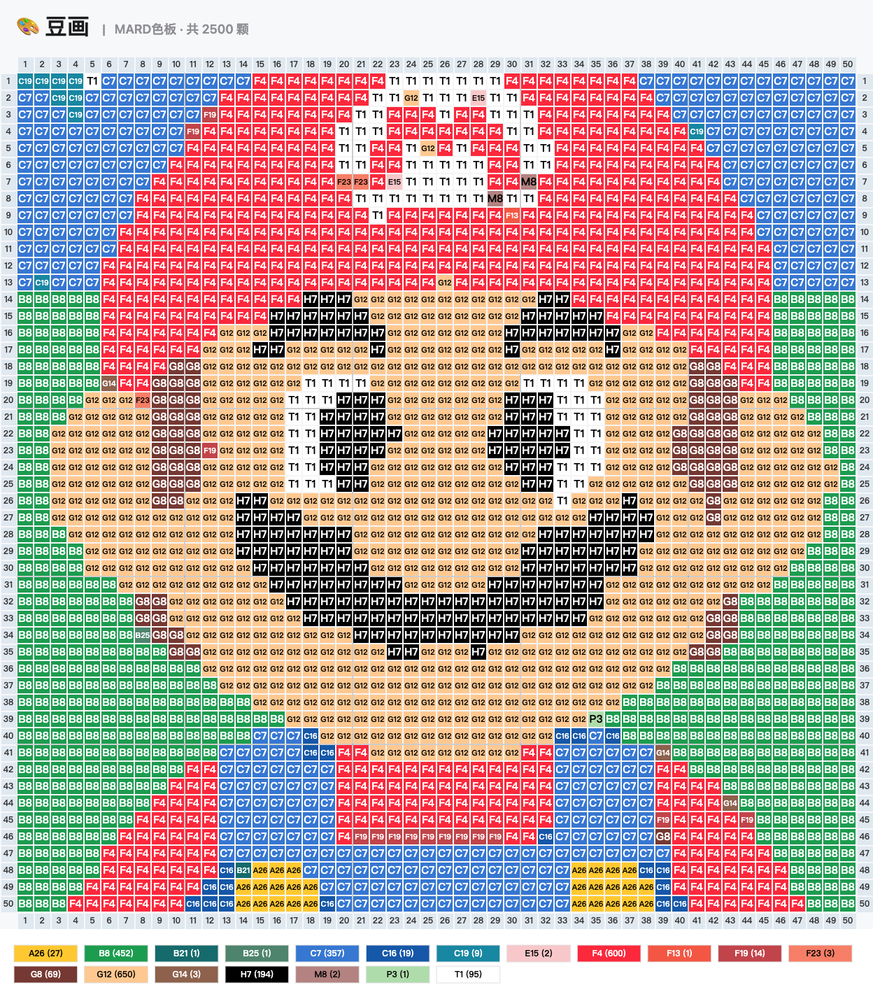
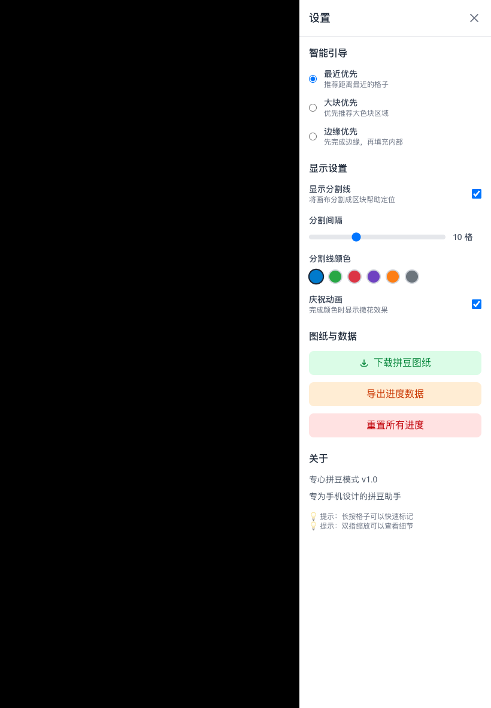
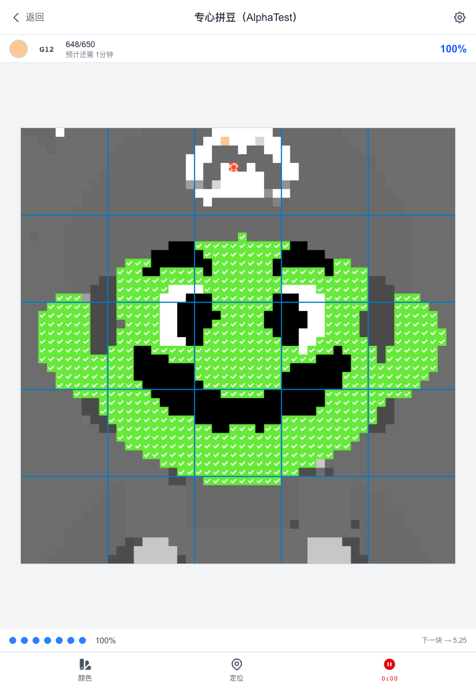

# PinBean Web 聚焦功能测试报告

**测试日期：** 2026-09-16  
**测试环境：** 腾讯云测试版 `http://119.45.7.74`，Chrome，820 × 1180 触控视口  
**测试重点：** 编辑、图纸导出、一起拼（页面中的“进入制作模式 / 专心拼豆”）  
**结论：** 编辑和图纸导出的核心任务可以完成；一起拼的标记进度和刷新恢复可用，但设置中的“导出进度数据”和“重置所有进度”是无效按钮。共发现 **2 个中等问题**，没有发现阻断编辑或导出的问题。

## 测试素材

只使用项目已有的单主题卡通图 `cartoon.png`。图片为单一马里奥头像，背景简单，适合判断轮廓、色块、格子编辑与导出结果；没有使用现实照片。

## 结果概览

| 功能 | 结果 | 主要证据 |
| --- | --- | --- |
| 图片导入与生成 | 通过 | 生成 50 × 50 图纸，共 2,500 格、19 色 |
| 单格改色 | 通过 | 修改后项目网格数据同步变化 |
| 撤销与重做 | 通过 | 撤销恢复原色，重做恢复修改结果 |
| 排除杂色与撤销排除 | 通过 | 排除后网格重映射，撤销后逐格恢复 |
| 编辑画布缩放 | 通过 | 放大后画布尺寸按 125% 变化，复位可用 |
| PNG 图纸导出 | 通过 | 输出 1248 × 1428 PNG，267,204 字节；已人工查看，坐标、格内色号和色号统计可读 |
| CSV 源数据导出 | 通过 | 输出 50 行 × 50 列 CSV，19 种颜色值，各行列数一致 |
| 进入一起拼 | 通过 | 能从工作台进入 `/focus` 制作页面 |
| 按区域标记完成 | 通过 | 点击推荐区域后标记 648 格，页面显示 648/650 |
| 制作进度恢复 | 通过 | 刷新页面后仍保留 648 个已完成格 |
| 制作模式下载图纸入口 | 入口通过 | 设置面板可打开“下载图纸设置”；本轮未重复执行文件下载 |
| 导出进度数据 | **失败** | 点击无下载、无提示、页面无变化 |
| 重置所有进度 | **失败** | 点击后仍为 648 个完成格，刷新后也未清零 |

导出的施工图能够保留卡通主体、坐标、每格色号和用量统计：

## 问题 1：导出进度数据按钮点击无反应

**严重度：中等**  
**影响：** 用户已经完成一部分拼豆后，无法通过页面提供的入口备份或转移制作进度。“图纸下载”只能导出施工图，不能替代进度数据备份。

**复现步骤：**

1. 生成图纸并进入“制作模式”。
2. 点击推荐区域，使当前颜色出现完成进度。
3. 打开右上角设置。
4. 点击“导出进度数据”。

**实际结果：** 没有产生下载文件，没有成功或失败提示，按钮外观和页面状态都没有变化。  
**预期结果：** 下载包含当前制作进度的数据文件，并给出明确的下载反馈；如果功能尚未开放，应禁用按钮并说明原因。

## 问题 2：重置所有进度按钮点击无反应

**严重度：中等**  
**影响：** 用户无法重新开始同一张图纸。误标了大量区域或需要重做时，只能手动逐区域取消，操作成本很高。

**复现步骤：**

1. 在制作模式中先标记一个区域，本轮结果为 648/650。
2. 打开右上角设置。
3. 点击“重置所有进度”。
4. 关闭设置或刷新页面检查进度。

**实际结果：** 完成格仍为 648，刷新后仍然保留。没有确认框，也没有结果提示。  
**预期结果：** 先提示用户确认；确认后清空全部完成格并将进度恢复为 0。

下面的设置界面同时显示了两个无效入口：

重置测试前后，当前颜色的进度都保持为 648/650：

## 产品判断与处理顺序

编辑和施工图导出已经具备测试使用条件，可以继续让用户在 iPad 上验证 Pencil 手感和实际制作流程。一起拼的核心价值是记录制作进度，因此建议先补上“重置所有进度”，并增加确认步骤防止误清空；随后实现“导出进度数据”，或在功能完成前将按钮置灰并标注“开发中”，避免用户把无响应理解为设备问题。制作模式内的下载入口本轮只验证到下载设置能够打开，实际文件下载结论沿用工作台导出测试，不在这里重复计算为一次完整通过。

## 测试边界

本轮使用线上真实部署和浏览器触控视口完成任务测试，没有修改产品代码。编辑结果、下载文件结构与本地进度持久化均做了数据核对；PNG 另外进行了人工查看。本轮没有覆盖 AI 图片优化、全部品牌色板、极端尺寸和所有设置组合，也没有代替 iPad 上 Apple Pencil 的真实手感测试。
